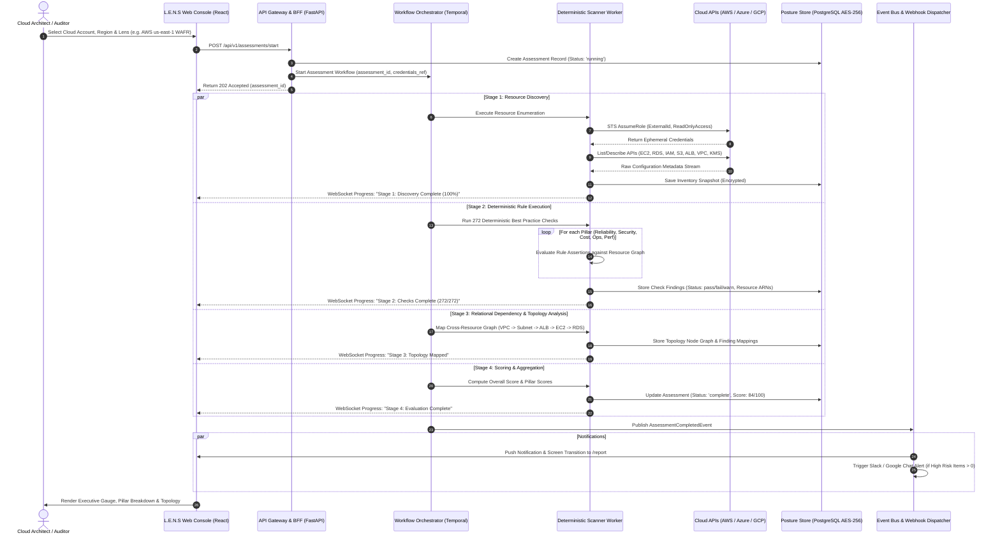
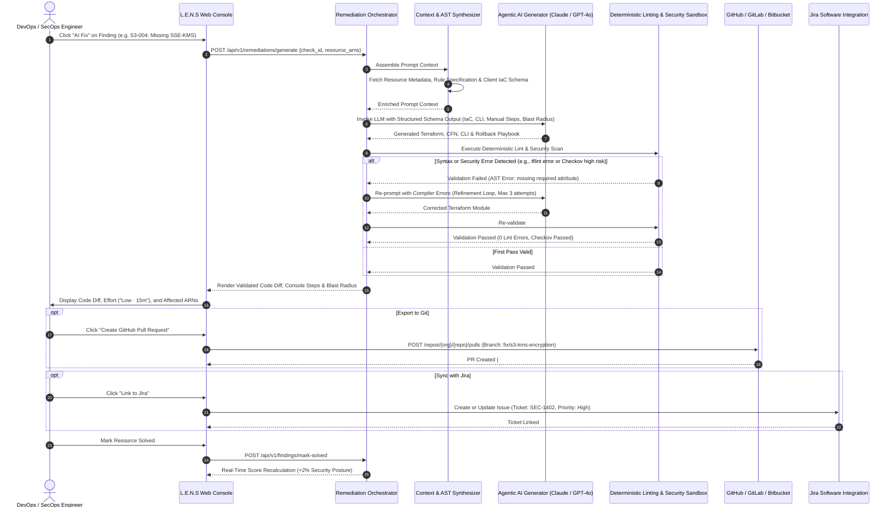
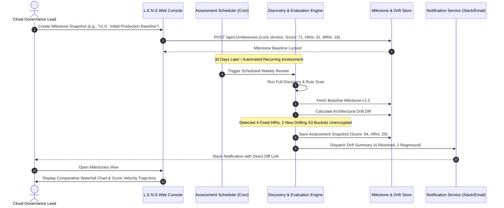
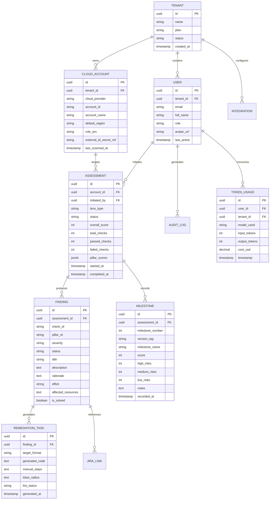
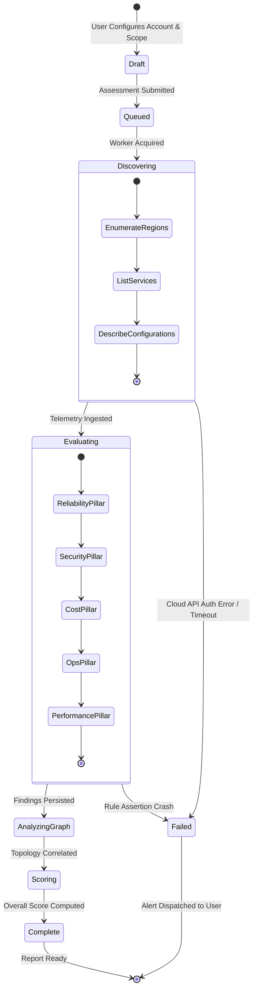
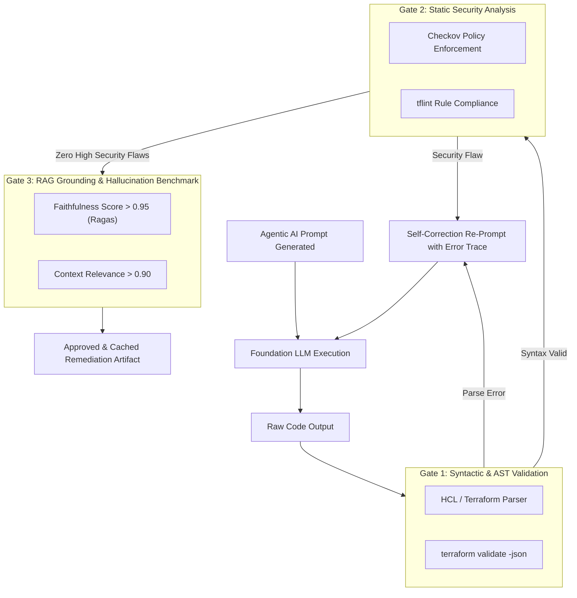
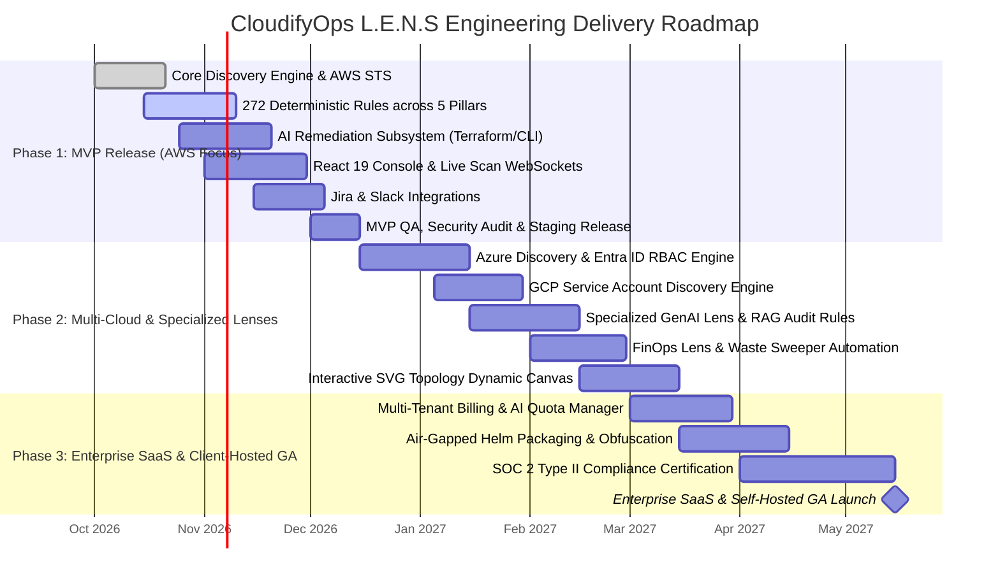

# CloudifyOps L.E.N.S — Comprehensive Product Requirements Document & Solution Architecture Specification

> **Document Version:** 1.0.0-PROD  
> **Classification:** Internal Engineering & Architecture Brainstorming Specification  
> **Platform Name:** **L.E.N.S** (*Live Evaluation & Non-invasive Scanning / Unified Cloud WAFR Platform*)  
> **Author:** CloudifyOps Engineering & Architecture Team  
> **Target Audience:** Engineering Leads, Cloud Architects, Product Managers, SecOps, FinOps, DevOps Teams  

---

## Table of Contents
1. [Executive Summary & Platform Vision](#1-executive-summary--platform-vision)
2. [End-to-End Swimlane Diagrams](#2-end-to-end-swimlane-diagrams)
   - 2.1 Multi-Cloud Discovery & Live Assessment Pipeline
   - 2.2 AI Remediation & IaC GitOps Generation Workflow
   - 2.3 Milestone Lifecycle & Continuous Drift Detection
3. [Product Requirements Document (PRD)](#3-product-requirements-document-prd)
   - 3.1 Target Personas & Primary Value Drivers
   - 3.2 Functional Requirements (FR-1 through FR-9)
   - 3.3 Non-Functional Requirements (NFR-1 through NFR-8)
4. [Data Schemas & Entity Specifications](#4-data-schemas--entity-specifications)
   - 4.1 Relational Entity-Relationship Diagram (ERD)
   - 4.2 Core TypeScript Interfaces & PostgreSQL DDL Schemas
5. [Tech Stack Specification](#5-tech-stack-specification)
   - 5.1 Frontend Architecture
   - 5.2 Backend API & Gateway
   - 5.3 Deterministic Rule Engine
   - 5.4 Agentic AI & Remediation Subsystem
   - 5.5 State & Workflow Orchestration
   - 5.6 Data Stores, Caching & Vector Search
   - 5.7 Authentication, Secrets & Security
6. [High-Level Solution Architecture & Technical Approach](#6-high-level-solution-architecture--technical-approach)
   - 6.1 System Architecture Diagram
   - 6.2 Deterministic vs. AI Division of Responsibilities
   - 6.3 Orchestration & Distributed Workflow Management
   - 6.4 State Tracking & Assessment Lifecycle Machine
   - 6.5 Microservices Decomposition & Interaction Patterns
7. [Wireframes & Screen Inventory](#7-wireframes--screen-inventory)
8. [Critical Engineering & Strategic Discussions](#8-critical-engineering--strategic-discussions)
   - 8.1 CI/CD Strategy for SaaS & Client-Hosted Deployments
   - 8.2 Evaluation Framework for Agentic AI & Test Suite for Deterministic Rules
   - 8.3 Source Code & IP Protection in Client-Hosted / On-Prem Deployments
   - 8.4 Roadmap, Timelines & Effort Estimations (MVP to Enterprise SaaS)
   - 8.5 Licensing Model Recommendations (For Future Implementation)

---

## 1. Executive Summary & Platform Vision

### 1.1 The Industry Problem: The "Assessment-to-Remediation" Gap
Organizations migrating to and scaling across Amazon Web Services (AWS), Microsoft Azure, and Google Cloud Platform (GCP) struggle to maintain architectural integrity, security postures, and cost efficiency. The standard industry mechanism—the **Well-Architected Framework Review (WAFR)**—suffers from four chronic operational flaws:
1. **Manual & Labor-Intensive**: Reviews rely on multi-week consultant interviews, subjective spreadsheets, and outdated tribal knowledge.
2. **Shelf-Ware Deliverables**: Reports often exceed 100 pages of text with zero executable remediation code, accumulating as technical debt on Jira backlogs.
3. **Temporal Blind Spots**: Point-in-time assessments decay immediately as continuous deployment pipelines push dozens of infrastructure changes daily.
4. **Multi-Cloud Fragmentation**: Native cloud tools (AWS Well-Architected Tool, Azure Advisor, GCP Architecture Center) operate in silos with disconnected scoring rubrics, disparate IAM models, and zero unified executive visibility.

### 1.2 The L.E.N.S Solution
**CloudifyOps L.E.N.S** transforms cloud architectural governance from a periodic audit into an **automated, continuous, and AI-accelerated operational engine**:
- **Agentless, Read-Only Discovery**: Connects via native IAM protocols (AWS STS `AssumeRole` with `ExternalId`, Azure Entra ID Service Principals, GCP Service Accounts) with zero workload binaries and zero customer application data access.
- **Dual-Scope Correlation**: Unifies organizational governance policies (root account MFA, compliance certifications, disaster recovery SLAs) with ground-level runtime telemetry (270+ deterministic infrastructure checks).
- **Automated AI Remediation Engine**: Synthesizes failing checks into production-ready, syntax-validated Terraform modules, CloudFormation templates, parameterized CLI commands, and step-by-step console playbooks.
- **Interactive Visual Architecture Topology**: Renders live SVG dependency graphs with dynamic risk pulsing and click-to-finding drilldowns.
- **Milestone Engine & Historical Drift Tracking**: Locks versioned architectural milestones to quantify risk burndown (HRIs/MRIs resolved) and prove security/cost ROI over time.
- **Modular Architecture Lenses**: Extensible architecture supporting Core WAFR, GenAI (LLM/RAG safety and latency), and FinOps (unit economics and waste sweeping).

---

## 2. End-to-End Swimlane Diagrams

### 2.1 Multi-Cloud Discovery & Live Assessment Pipeline

This sequence captures the complete flow from an Architect initiating a scan to the generation of deterministic findings and real-time frontend streaming.



---

### 2.2 AI Remediation & IaC GitOps Generation Workflow

This swimlane demonstrates how failing architectural checks are translated into verified Terraform pull requests, balancing agentic LLM code generation with deterministic linting and safety checks.



---

### 2.3 Milestone Lifecycle & Continuous Drift Detection



---

## 3. Product Requirements Document (PRD)

### 3.1 Target Personas & Primary Value Drivers

| Persona | Key Objectives | Critical Pain Points Solved by L.E.N.S |
| :--- | :--- | :--- |
| **CISO / Head of Security** | Continuous compliance, zero breach exposure, board-level risk visibility | Replaces annual subjective audit with real-time risk burndown metrics across multi-cloud footprints. Direct alignment to CIS, SOC 2, HIPAA, and ISO 27001. |
| **CTO / VP of Engineering** | Architectural stability, multi-region resilience, standardizing best practices | Unifies AWS, Azure, and GCP under a single governance standard. Eliminates tribal knowledge and architectural decay between release cycles. |
| **Head of FinOps** | Eliminating cloud waste, commitment coverage, unit cost predictability | Automatically surfaces unattached block storage, orphaned IPs, obsolete snapshot chains, and under-utilized Savings Plans with clear dollar ROI. |
| **Cloud Architect** | Designing fault-tolerant systems, validating IaC integrity, visualizing dependencies | Interactive live SVG topology diagram mapping cross-resource relationships; dual-scope correlation connecting organizational policies to cloud configurations. |
| **DevOps / SecOps Engineer** | Rapid ticket burndown, avoiding manual script writing, zero production downtime | Instant generation of validated Terraform modules, CloudFormation templates, CLI scripts, and console playbooks with estimated effort and blast radius. |

---

### 3.2 Functional Requirements (FR)

#### FR-1: Non-Invasive Multi-Cloud Discovery Engine
- **FR-1.1**: The platform MUST authenticate to AWS accounts using AWS STS `AssumeRole` with a mandatory unique `ExternalId` parameter to prevent the Confused Deputy vulnerability.
- **FR-1.2**: The platform MUST connect to Azure subscriptions via Azure Entra ID (formerly Azure AD) Service Principals scoped with strict `Reader` RBAC roles.
- **FR-1.3**: The platform MUST connect to Google Cloud Platform via IAM Service Accounts with `Viewer` permissions at the Organization, Folder, or Project level.
- **FR-1.4**: All discovery scans MUST be agentless, executing exclusively through provider control-plane APIs (e.g., `Describe*`, `Get*`, `List*`). Zero compute daemons or binaries shall be installed on target workloads.
- **FR-1.5**: Under no circumstances shall the platform request, store, or inspect customer database records, application file payloads, or S3 object content. Only configuration metadata shall be read.

#### FR-2: Dual-Scope Assessment Architecture
- **FR-2.1 Organizational Scope (Enterprise IT)**:
  - Provide a questionnaire covering root account hardware MFA, disaster recovery SLAs (RPO/RTO), centralized logging architectures, FinOps tagging policies, and security incident response playbooks.
  - Support auditor evidence capture: Why It Matters, How to Verify (exact CLI/console path), Evidence Requirements (JSON outputs/screenshots), and interactive step verification checklists.
- **FR-2.2 Workload Scope (Account / Technical)**:
  - Deep inspection of VPC topology, subnet routing, multi-AZ database clustering, encryption at rest/in transit, backup retention windows, security group ingress rules, and WAF associations.

#### FR-3: Multi-Lens Evaluation Framework
- **FR-3.1 Core WAFR Lens**: Native support for the 5 Well-Architected Framework Pillars:
  - *Reliability (R)*: Multi-AZ failovers, cross-region replication, Route 53 health checks, SQS dead-letter queues.
  - *Security (S)*: IAM wildcard pruning, CMK KMS encryption, security group 0.0.0.0/0 ingress prevention, GuardDuty threat detection.
  - *Cost Optimization (C)*: Idle volume purges, snapshot lifecycle pruning, Savings Plans coverage, modern ARM64 Graviton instances.
  - *Operational Excellence (O)*: Infrastructure-as-Code coverage, blue/green canary pipelines, OpenTelemetry structured logging.
  - *Performance Efficiency (P)*: CloudFront CDN distribution, ElastiCache Redis clustering, gp3 IOPS configuration.
- **FR-3.2 GenAI Lens**: Specialized audit rules evaluating LLM/RAG deployments (prompt injection defenses, vector database latency/sharding, token cost attribution, and model safety guardrails).
- **FR-3.3 FinOps Lens**: Unit cost economics, chargeback/showback tagging fidelity, real-time anomaly detection, and commitment arbitrage.

#### FR-4: Real-Time Live Scan Execution
- **FR-4.1**: Multi-stage progress visualizer tracking Resource Discovery, Configuration Checks, Relational Analysis, and Scoring.
- **FR-4.2**: Real-time pass/fail/warning counter increments via WebSocket streams during active execution.
- **FR-4.3**: Scan duration for standard enterprise cloud accounts (up to 1,000 resources) MUST complete within 90 seconds.

#### FR-5: Interactive Visual Architecture Topology
- **FR-5.1**: Dynamically render SVG topology mapping Internet Gateway -> WAF -> ALB -> Public Subnet -> Private Compute Subnet (EC2, Lambda, EKS) -> Private Data Subnet (RDS, ElastiCache) -> S3/KMS.
- **FR-5.2**: Nodes with failing architectural checks MUST pulse with high-visibility status badges (e.g., Red for Critical/High, Amber for Medium).
- **FR-5.3**: Clicking any component node MUST open an inspector drawer detailing associated findings, rule descriptions, and direct 1-click links to the AI Remediation playbook.

#### FR-6: Automated AI Remediation Subsystem (IaC-Ready)
- **FR-6.1**: For every failed check, generate four synchronized remediation paths:
  1. *Production Terraform (`.tf`)*: Fully parameterized modules adhering to HashiCorp standards with input variables, outputs, and state locking.
  2. *AWS CloudFormation / Azure Bicep*: Native cloud declarative templates.
  3. *CLI Script*: Executable bash/PowerShell commands with parameter placeholders for staging validation.
  4. *Step-by-Step Console Guide*: Explicit navigation instructions for manual web console execution.
- **FR-6.2**: Calculate and display estimated remediation effort ("Low Effort · 15m", "Medium Effort · 45m", "High Effort · 2h") and blast radius risk warnings (e.g., "Potential downtime if database restart is triggered").
- **FR-6.3**: Interactive item resolution tracking allowing engineers to mark resources `fixed`, `cant_fix`, or `pending`, dynamically recalculating pillar scores in real time.

#### FR-7: Milestone Versioning & Drift Tracking
- **FR-7.1**: Capability to record immutable snapshot baselines (Milestone Name, Version, Notes, High/Medium/Low Risk counts, Overall & Pillar Scores).
- **FR-7.2**: Historical comparison engine displaying score trajectory across 30/60/90-day intervals, proving measurable risk burndown to executives and auditors.

#### FR-8: Ecosystem Integrations & Workflows
- **FR-8.1 Git Providers**: Connect with GitHub, GitLab, and Bitbucket via Personal Access Tokens (PAT) or OAuth App to export AI-generated Terraform modules as pull requests.
- **FR-8.2 Ticketing & Issue Tracking**: Bi-directional integration with Jira Cloud/Server to convert findings into prioritized issues (linking Check ID, Severity, Description, and affected resource ARNs).
- **FR-8.3 Messaging & Webhooks**: Dispatch formatted alert cards to Slack channels and Google Chat spaces for newly detected critical/high risk items or completed assessments.

#### FR-9: Multi-Tenancy, Administration & AI Quota Governance
- **FR-9.1**: Strict tenant isolation supporting multi-division enterprises and Managed Service Providers (MSPs).
- **FR-9.2 Role-Based Access Control (RBAC)**: Support for Administrator, Cloud Architect, Auditor, and Read-Only Viewer roles.
- **FR-9.3 AI Token Quota Management**: Centralized administrator dashboard tracking token consumption, dollar cost per user and organization, with hard and soft budget limits.

---

### 3.3 Non-Functional Requirements (NFR)

| ID | Category | Requirement Specification |
| :--- | :--- | :--- |
| **NFR-1** | **Security & Encryption** | All network communications MUST enforce **TLS 1.3** (TLS 1.2 fallback). All persistent data at rest MUST be encrypted using **AES-256 with KMS Customer Managed Keys (CMK)**. Zero persistent caching of customer application payloads. |
| **NFR-2** | **Zero-Trust IAM** | IAM role permissions granted to L.E.N.S scanners MUST be strictly read-only (`Get*`, `List*`, `Describe*`). The scanner MUST possess zero write permissions on customer infrastructure during review mode. |
| **NFR-3** | **Performance & Latency** | Web UI initial load time < 1.5 seconds. P95 API response time < 200ms. End-to-end cloud scan execution < 90 seconds for accounts with < 1,000 resources. AI remediation generation < 8 seconds. |
| **NFR-4** | **Availability & Resilience** | Platform availability SLA of **99.9%** for SaaS deployments. Stateless worker nodes with automatic horizontal pod autoscaling (HPA) based on queue depth. Exponential backoff and retry jitter against cloud rate limits (e.g. AWS `RequestLimitExceeded`). |
| **NFR-5** | **Scalability** | Must support concurrent evaluation of 100+ cloud accounts without performance degradation. Database schema partitioned by `tenant_id` and indexed for time-series milestone queries. |
| **NFR-6** | **Data Sovereignty & Purging** | Configurable data retention windows (7 to 365 days) for raw scan telemetry. Automated purge daemon executing daily at 02:00 UTC to permanently shred expired snapshots. |
| **NFR-7** | **Deployment Portability** | Must support three distinct deployment topologies: (1) CloudifyOps Multi-Tenant SaaS, (2) Single-Tenant Dedicated Customer VPC (AWS/Azure/GCP), and (3) Fully Air-Gapped On-Premises Kubernetes Cluster. |
| **NFR-8** | **Auditability & Traceability** | Immutable structured JSON audit logs for every user action, scan dispatch, AI code generation, and configuration change, exportable to Datadog, Splunk, or Amazon CloudWatch. |

---

## 4. Data Schemas & Entity Specifications

### 4.1 Relational Entity-Relationship Diagram (ERD)



---

### 4.2 Core TypeScript Interfaces & PostgreSQL DDL Schemas

#### Core TypeScript Interfaces

```typescript
// ==========================================
// L.E.N.S Core Domain TypeScript Definitions
// ==========================================

export type CloudProvider = 'aws' | 'azure' | 'gcp';
export type LensType = 'wafr' | 'genai' | 'finops';
export type FindingSeverity = 'critical' | 'high' | 'medium' | 'low' | 'info';
export type AssessmentStatus = 'draft' | 'queued' | 'running' | 'complete' | 'failed';
export type UserRole = 'admin' | 'architect' | 'auditor' | 'viewer';

export interface CloudAccount {
  id: string;
  tenantId: string;
  provider: CloudProvider;
  accountId: string;
  accountName: string;
  defaultRegion: string;
  authConfig: {
    roleArn?: string;                  // AWS STS Role
    externalIdSecretRef?: string;      // AWS ExternalId KMS Pointer
    tenantId?: string;                 // Azure Entra Tenant
    clientId?: string;                 // Azure Client ID
    serviceAccountKeyRef?: string;     // GCP KMS Secret Ref
  };
  createdAt: string;
  lastScannedAt?: string;
}

export interface PillarScoreBreakdown {
  reliability: number;
  security: number;
  cost: number;
  operations: number;
  performance: number;
}

export interface AssessmentRecord {
  id: string;
  tenantId: string;
  accountId: string;
  accountName: string;
  cloud: CloudProvider;
  region: string;
  lens: LensType;
  status: AssessmentStatus;
  score: number;
  totalChecks: number;
  passedChecks: number;
  failedChecks: number;
  warnChecks: number;
  pillars: PillarScoreBreakdown;
  startedAt: string;
  completedAt?: string;
  initiatedByUserId: string;
}

export interface FindingDetail {
  id: string;
  assessmentId: string;
  checkId: string;                  // e.g. "REL-CHK-102", "SEC-S3-KMS"
  pillarId: 'reliability' | 'security' | 'cost' | 'operations' | 'performance';
  severity: FindingSeverity;
  status: 'pass' | 'fail' | 'warn';
  title: string;
  description: string;
  rationale: string;
  effort: 'Low' | 'Medium' | 'High';
  estTime: string;                  // e.g. "15 min"
  affectedResources: string[];      // List of ARNs or Azure Resource IDs
  isSolved: boolean;
}

export interface AIRemediationPayload {
  checkId: string;
  findingId: string;
  riskSummary: string;
  blastRadius: {
    level: 'Low' | 'Medium' | 'High';
    description: string;
    downtimeExpected: boolean;
  };
  codeArtifacts: {
    terraform: string;
    cloudFormation: string;
    cliCommand: string;
    cliExplanation: string;
  };
  manualPlaybook: Array<{
    stepNumber: number;
    title: string;
    instruction: string;
    consoleUrlPath?: string;
  }>;
  validationStatus: 'verified' | 'lint_warning' | 'syntax_error';
}

export interface MilestoneSnapshot {
  id: string;
  assessmentId: string;
  tenantId: string;
  milestoneNumber: number;
  version: string;                  // e.g. "v1.2"
  milestoneName: string;
  score: number;
  highRisks: number;
  mediumRisks: number;
  lowRisks: number;
  pillarScores: PillarScoreBreakdown;
  notes: string;
  recordedBy: string;
  recordedAt: string;
}
```

#### Production PostgreSQL DDL

```sql
-- Enable UUID and Cryptographic Extensions
CREATE EXTENSION IF NOT EXISTS "uuid-ossp";
CREATE EXTENSION IF NOT EXISTS "pgcrypto";

-- Tenants Table
CREATE TABLE tenants (
    id UUID PRIMARY KEY DEFAULT uuid_generate_v4(),
    name VARCHAR(255) NOT NULL,
    plan VARCHAR(50) DEFAULT 'Enterprise' CHECK (plan IN ('Starter', 'Pro', 'Enterprise', 'Custom')),
    status VARCHAR(50) DEFAULT 'Active' CHECK (status IN ('Active', 'Inactive', 'Suspended')),
    created_at TIMESTAMPTZ DEFAULT CURRENT_TIMESTAMP,
    updated_at TIMESTAMPTZ DEFAULT CURRENT_TIMESTAMP
);

-- Cloud Accounts Table
CREATE TABLE cloud_accounts (
    id UUID PRIMARY KEY DEFAULT uuid_generate_v4(),
    tenant_id UUID NOT NULL REFERENCES tenants(id) ON DELETE CASCADE,
    provider VARCHAR(20) NOT NULL CHECK (provider IN ('aws', 'azure', 'gcp')),
    account_id VARCHAR(100) NOT NULL,
    account_name VARCHAR(255) NOT NULL,
    default_region VARCHAR(50) NOT NULL,
    role_arn VARCHAR(512),
    external_id_vault_key VARCHAR(255),
    created_at TIMESTAMPTZ DEFAULT CURRENT_TIMESTAMP,
    last_scanned_at TIMESTAMPTZ,
    CONSTRAINT uk_tenant_account UNIQUE (tenant_id, provider, account_id)
);

-- Assessments Table
CREATE TABLE assessments (
    id UUID PRIMARY KEY DEFAULT uuid_generate_v4(),
    tenant_id UUID NOT NULL REFERENCES tenants(id) ON DELETE CASCADE,
    account_id UUID NOT NULL REFERENCES cloud_accounts(id) ON DELETE CASCADE,
    lens_type VARCHAR(50) DEFAULT 'wafr' CHECK (lens_type IN ('wafr', 'genai', 'finops')),
    status VARCHAR(50) DEFAULT 'queued' CHECK (status IN ('draft', 'queued', 'running', 'complete', 'failed')),
    overall_score INT DEFAULT 0 CHECK (overall_score BETWEEN 0 AND 100),
    total_checks INT DEFAULT 0,
    passed_checks INT DEFAULT 0,
    failed_checks INT DEFAULT 0,
    pillar_scores JSONB NOT NULL DEFAULT '{}'::jsonb,
    started_at TIMESTAMPTZ DEFAULT CURRENT_TIMESTAMP,
    completed_at TIMESTAMPTZ,
    initiated_by UUID
);

-- Findings Table
CREATE TABLE findings (
    id UUID PRIMARY KEY DEFAULT uuid_generate_v4(),
    assessment_id UUID NOT NULL REFERENCES assessments(id) ON DELETE CASCADE,
    check_id VARCHAR(100) NOT NULL,
    pillar_id VARCHAR(50) NOT NULL CHECK (pillar_id IN ('reliability', 'security', 'cost', 'operations', 'performance')),
    severity VARCHAR(20) NOT NULL CHECK (severity IN ('critical', 'high', 'medium', 'low', 'info')),
    status VARCHAR(20) NOT NULL CHECK (status IN ('pass', 'fail', 'warn')),
    title VARCHAR(512) NOT NULL,
    description TEXT,
    rationale TEXT,
    effort VARCHAR(20) DEFAULT 'Medium' CHECK (effort IN ('Low', 'Medium', 'High')),
    affected_resources JSONB DEFAULT '[]'::jsonb,
    is_solved BOOLEAN DEFAULT FALSE,
    solved_at TIMESTAMPTZ,
    solved_by UUID
);

-- Milestones Table
CREATE TABLE milestones (
    id UUID PRIMARY KEY DEFAULT uuid_generate_v4(),
    assessment_id UUID NOT NULL REFERENCES assessments(id) ON DELETE CASCADE,
    tenant_id UUID NOT NULL REFERENCES tenants(id) ON DELETE CASCADE,
    milestone_number INT NOT NULL,
    version_tag VARCHAR(50) NOT NULL,
    milestone_name VARCHAR(255) NOT NULL,
    score INT NOT NULL CHECK (score BETWEEN 0 AND 100),
    high_risks INT NOT NULL DEFAULT 0,
    medium_risks INT NOT NULL DEFAULT 0,
    low_risks INT NOT NULL DEFAULT 0,
    pillar_scores JSONB NOT NULL DEFAULT '{}'::jsonb,
    notes TEXT,
    recorded_by VARCHAR(255) NOT NULL,
    recorded_at TIMESTAMPTZ DEFAULT CURRENT_TIMESTAMP
);

-- Indexes for Fast Query Performance
CREATE INDEX idx_assessments_tenant ON assessments(tenant_id, started_at DESC);
CREATE INDEX idx_findings_assessment ON findings(assessment_id, pillar_id, severity);
CREATE INDEX idx_milestones_assessment ON milestones(assessment_id, milestone_number ASC);
```

---

## 5. Tech Stack Specification

| Layer | Technology Selected | Rationale & Enterprise Justification |
| :--- | :--- | :--- |
| **Frontend Framework** | **React 19, TypeScript 5.9, Vite 8** | Modern reactive UI paradigm with instant HMR and strict type safety across all screens. |
| **Styling & Design System** | **Tailwind CSS v4 (`@tailwindcss/vite`)** | Zero runtime CSS overhead, native variable theming (Light/Dark mode), and consistent utility tokens. |
| **Backend API / Gateway** | **Python 3.12 with FastAPI & Pydantic v2** | High-concurrency async endpoints, automated OpenAPI specification, and seamless integration with AI libraries. |
| **Scanner Worker Engine** | **Go (Golang 1.23) / Python Asyncio** | High-throughput concurrent querying of AWS/Azure/GCP SDKs; Goroutines handle multi-region API pagination efficiently. |
| **Workflow Orchestration** | **Temporal.io** | Durable, code-first workflow orchestration; guarantees state recovery across transient cloud timeouts and network failures. |
| **Primary Database** | **PostgreSQL 16 (AWS Aurora / Cloud SQL)** | ACID transactional integrity, robust JSONB support for dynamic findings metadata, Row-Level Security (RLS) for multi-tenancy. |
| **Caching & Rate Limiting** | **Redis 7 (ElastiCache / MemoryStore)** | Ephemeral scan state storage, rate-limiting cloud API calls, and pub/sub message brokering for live scan WebSockets. |
| **Vector Database (GenAI)** | **pgvector / Qdrant** | Semantic retrieval of hyperscaler documentation, WAFR whitepaper guidelines, and verified Terraform module catalogs for RAG. |
| **LLM & Agentic AI** | **Claude 3.5 Sonnet / GPT-4o / Gemini 1.5 Pro via LangGraph** | State-of-the-art coding reasoning; structured JSON schema enforcement via instructor/outlines; multi-step self-correction. |
| **IaC Linting & Validation** | **HashiCorp Terraform CLI, `tflint`, Checkov** | Deterministic static analysis verifying syntax, formatting, and security policies on AI-generated Terraform modules before PR dispatch. |
| **Authentication & IAM** | **Keycloak 24 / AWS Cognito / OIDC** | Enterprise SSO supporting SAML 2.0, OAuth2/OIDC, Google/Microsoft Social Auth, and granular RBAC. |
| **Container & Orchestration** | **Docker, Kubernetes (Amazon EKS / Helm v3)** | Cloud-agnostic container packaging; enables uniform deployment across CloudifyOps SaaS, client VPCs, and air-gapped on-prem. |

---

## 6. High-Level Solution Architecture & Technical Approach

### 6.1 System Architecture Diagram

```mermaid
graph TD
    subgraph ClientLayer ["Client & Interaction Layer"]
        Browser["React 19 Web Console (Tailwind v4)"]
        CLI["L.E.N.S Developer CLI"]
        WebhookClient["Jira / Slack / GitHub Integrations"]
    end

    subgraph IngressLayer ["Ingress & Perimeter Defense"]
        ALB["Cloud Application Load Balancer / WAF"]
        APIGW["FastAPI API Gateway & BFF (TLS 1.3)"]
        Keycloak["Keycloak / OIDC Auth Provider"]
    end

    subgraph CorePlatform ["L.E.N.S Core Microservices Cluster (Kubernetes)"]
        OrchService["Temporal Workflow Orchestrator"]
        DiscoverySvc["Multi-Cloud Discovery Service"]
        RuleEngine["Deterministic WAFR Rule Engine (272+ Rules)"]
        TopologySvc["Visual Topology & Graph Engine"]
        MilestoneSvc["Milestone & Drift Analytics Service"]
        AdminSvc["Tenant & AI Token Quota Manager"]
        
        subgraph AISubsystem ["Agentic AI Remediation Subsystem"]
            AIAgent["LangGraph Remediation Agent"]
            LLMCluster["Foundation Models (Claude 3.5 / GPT-4o)"]
            LintSandbox["Deterministic Validation Sandbox (tflint / checkov)"]
        end
    end

    subgraph DataStorage ["Data & Cache Tier (Encrypted AES-256 KMS)"]
        Postgres[(PostgreSQL 16 Multi-Tenant DB)]
        RedisCache[(Redis 7 Cache & PubSub)]
        VectorDB[(pgvector Best Practice Store)]
        Vault[(HashiCorp Vault / AWS Secrets Manager)]
    end

    subgraph TargetClouds ["Target Cloud Environments (Read-Only Control Plane)"]
        AWS["Amazon Web Services (STS AssumeRole)"]
        Azure["Microsoft Azure (Entra ID Service Principal)"]
        GCP["Google Cloud Platform (Service Account Viewer)"]
    end

    Browser -->|HTTPS / WSS| ALB
    CLI -->|HTTPS| ALB
    ALB --> APIGW
    APIGW --> Keycloak
    APIGW --> OrchService
    APIGW --> Postgres
    APIGW --> RedisCache

    OrchService --> DiscoverySvc
    OrchService --> RuleEngine
    OrchService --> TopologySvc
    OrchService --> AIAgent

    DiscoverySvc -->|AssumeRole + ExternalId| AWS
    DiscoverySvc -->|OIDC Token| Azure
    DiscoverySvc -->|Service Account JWT| GCP

    RuleEngine --> Postgres
    TopologySvc --> Postgres
    MilestoneSvc --> Postgres
    AdminSvc --> Postgres

    AIAgent --> VectorDB
    AIAgent --> LLMCluster
    AIAgent --> LintSandbox
    LintSandbox -->|Validated PR| WebhookClient
```



---

### 6.2 Deterministic vs. AI Division of Responsibilities

A foundational design principle of L.E.N.S is that **deterministic compliance checks and scoring must NEVER be delegated to probabilistic LLMs**. AI is leveraged strictly for contextual synthesis, explanation, and code generation.

```
┌────────────────────────────────────────────────────────────────────────────────────────┐
│                   DIVISION OF ARCHITECTURAL RESPONSIBILITIES                           │
├───────────────────────────────────────────┬────────────────────────────────────────────┤
│     DETERMINISTIC SUBSYSTEM               │        AGENTIC AI SUBSYSTEM                │
│     (Code-Based, 100% Predictable)        │        (LLM-Driven, Contextual Synthesis)   │
├───────────────────────────────────────────┼────────────────────────────────────────────┤
│ • Cloud API resource enumeration          │ • Architectural root-cause explanation     │
│ • 272+ configuration rule assertions      │ • Customized Terraform (`.tf`) generation  │
│ • Numerical pillar & overall scoring      │ • CloudFormation & CLI command translation │
│ • Network topology graph construction     │ • Step-by-step console navigation guides   │
│ • Historical milestone drift diffing      │ • Blast radius & operational risk summary  │
│ • Multi-tenant RBAC & token budget checks │ • Natural language architecture chat copilot│
│ • Jira ticket creation & Slack dispatch   │ • Self-healing syntax correction loops     │
└───────────────────────────────────────────┴────────────────────────────────────────────┘
```

#### Detailed Breakdown Table:

| Subsystem Task | Responsible Engine | Mechanism & Implementation |
| :--- | :--- | :--- |
| **Configuration Audit** | **Deterministic** | Pure function evaluations: AST inspection, boolean logic (e.g. `bucket.server_side_encryption_configuration != null`). |
| **Score Calculation** | **Deterministic** | Mathematical formula: `(Passed Checks / Total Applicable Checks) * 100` weighted by pillar risk level. |
| **Topology Rendering** | **Deterministic** | Directed Acyclic Graph (DAG) construction based on explicit VPC Subnet CIDRs, Route Tables, and Target Group ARNs. |
| **Remediation IaC Generation** | **Agentic AI** | LLM synthesized code informed by target resource metadata, naming conventions, and client provider version. |
| **IaC Code Verification** | **Deterministic** | Automated execution of `terraform fmt -check`, `tflint`, and `checkov -d .` inside an ephemeral container sandbox. |
| **Milestone Diffing** | **Deterministic** | Set-based mathematical difference: `Current_Failed_Checks ⊖ Baseline_Failed_Checks`. |
| **Copilot Q&A** | **Agentic AI** | Retrieval-Augmented Generation (RAG) over hyperscaler WAFR documentation and active scan findings. |

---

### 6.3 Orchestration & Distributed Workflow Management

Scans against enterprise cloud accounts involve thousands of API calls across multiple regions, subject to hyperscaler rate limiting (e.g., AWS `ThrottlingException`). L.E.N.S implements **Temporal.io** for workflow orchestration:
- **Durable Execution**: If a worker node crashes during a scan, Temporal resumes execution at the exact step without re-executing completed API queries.
- **Rate-Limiting & Jitter**: Cloud API calls are funneled through token-bucket rate limiters with exponential backoff and randomized jitter.
- **Dynamic Task Routing**: Scans across AWS, Azure, and GCP are dynamically dispatched to specialized worker pools equipped with cloud-specific SDKs.

---

### 6.4 State Tracking & Assessment Lifecycle Machine



---

### 6.5 Microservices Decomposition & Interaction Patterns

1. **API Gateway & BFF (`lens-gateway`)**: Exposes REST and WebSocket endpoints; validates JWT tokens via Keycloak; handles request rate limiting and payload validation.
2. **Discovery Service (`lens-discovery`)**: Asynchronously assumes target cloud credentials and streams raw cloud configuration metadata into encrypted temporary storage.
3. **Rule Evaluation Engine (`lens-evaluator`)**: High-performance rule execution pipeline running 272+ deterministic checks against the configuration metadata.
4. **Topology Engine (`lens-topology`)**: Maps VPC networking, route tables, subnets, and attached resources into an interactive SVG-ready JSON graph.
5. **AI Remediation Service (`lens-ai-remediator`)**: LangGraph-orchestrated service querying foundation LLMs with structured prompts to generate validated IaC modules.
6. **Milestone & Analytics Engine (`lens-milestones`)**: Manages immutable baseline snapshots, trendline calculations, and compliance framework cross-walks (SOC 2, ISO 27001, CIS).
7. **Integration & Notification Dispatcher (`lens-dispatcher`)**: Handles bi-directional synchronization with Jira, Slack, Google Chat, and Git providers.
8. **Tenant & Quota Manager (`lens-admin`)**: Tracks token consumption per user, manages organization budgets, and enforces tier feature gating.

---

## 7. Wireframes & Screen Inventory

The L.E.N.S platform is supported by an interactive wireframe suite designed in React 19 + Tailwind CSS v4. Below is the functional mapping of all screens and modal components:

```
┌────────────────────────────────────────────────────────────────────────────────────────┐
│                        L.E.N.S WIREFRAME SCREEN MAP & USER FLOWS                       │
├────────────────────┬─────────────────────────────┬─────────────────────────────────────┤
│ Screen Identifier  │ Primary Purpose             │ Key UI Components & Interactions    │
├────────────────────┼─────────────────────────────┼─────────────────────────────────────┤
│ `login`            │ Authentication & Role Demo  │ Fast user switching (Lezin VM,      │
│                    │                             │ Alex Rivera, Admin); Keycloak SSO   │
├────────────────────┼─────────────────────────────┼─────────────────────────────────────┤
│ `onboarding`       │ New User Guided Setup       │ 4-step wizard: Welcome, Add Account,│
│                    │                             │ Run First Scan, View Dashboard      │
├────────────────────┼─────────────────────────────┼─────────────────────────────────────┤
│ `dashboard`        │ Multi-Cloud Executive Posture│ Health donut, multi-cloud cards,    │
│                    │                             │ quick actions, recent activity feed │
├────────────────────┼─────────────────────────────┼─────────────────────────────────────┤
│ `select-cloud`     │ Provider Target Selection   │ AWS, Azure, GCP selector with       │
│                    │                             │ configuration modal triggers        │
├────────────────────┼─────────────────────────────┼─────────────────────────────────────┤
│ `select-lens`      │ Specialized Lens Picker     │ Core WAFR, GenAI Lens, FinOps Lens  │
├────────────────────┼─────────────────────────────┼─────────────────────────────────────┤
│ `org-questions`    │ Dual-Scope Enterprise Scope │ Enterprise IT governance checklist, │
│                    │                             │ verification steps, evidence audit  │
├────────────────────┼─────────────────────────────┼─────────────────────────────────────┤
│ `wizard`           │ Scan Configuration Wizard   │ Account ARN, region, workload tags  │
├────────────────────┼─────────────────────────────┼─────────────────────────────────────┤
│ `live-scan`        │ Real-Time Scan Execution    │ 4-stage live progress bar, counter  │
│                    │                             │ increments, WebSocket telemetry     │
├────────────────────┼─────────────────────────────┼─────────────────────────────────────┤
│ `report`           │ Assessment Executive Report │ Overall score gauge, 5 pillar cards,│
│                    │                             │ High/Med/Low risk tallies, PDF export│
├────────────────────┼─────────────────────────────┼─────────────────────────────────────┤
│ `pillar-detail`    │ Deep-Dive Pillar Breakdown  │ Best practice accordion, check lists,│
│                    │                             │ status pills, direct "AI Fix" links │
├────────────────────┼─────────────────────────────┼─────────────────────────────────────┤
│ `remediation` /    │ Autonomous AI Remediation   │ Validated Terraform/CFN code diff,  │
│ `ai-fix`           │                             │ CLI commands, manual steps, PR push │
├────────────────────┼─────────────────────────────┼─────────────────────────────────────┤
│ `diagram`          │ Interactive Architecture Topo│ Live SVG VPC map with pulsing risk  │
│                    │                             │ indicators and click-to-remediate   │
├────────────────────┼─────────────────────────────┼─────────────────────────────────────┤
│ `milestones`       │ Baseline & Drift Tracking   │ Milestone version cards, waterfall  │
│                    │                             │ score comparison, drift diffing     │
├────────────────────┼─────────────────────────────┼─────────────────────────────────────┤
│ `compliance`       │ Regulatory Framework Mapping│ CIS Benchmarks, SOC 2, HIPAA, PCI   │
│                    │                             │ mapping to passing/failing checks   │
├────────────────────┼─────────────────────────────┼─────────────────────────────────────┤
│ `integrations`     │ External DevOps Workflows   │ Jira Cloud, Slack Webhooks, GChat,  │
│                    │                             │ GitHub PR export settings & logs    │
├────────────────────┼─────────────────────────────┼─────────────────────────────────────┤
│ `settings`         │ Tenant Settings & Retention │ Data retention schedules (7-365d),  │
│                    │                             │ purge triggers, theme configuration │
├────────────────────┼─────────────────────────────┼─────────────────────────────────────┤
│ `admin`            │ Enterprise Governance       │ User management, token quotas, plan │
│                    │                             │ assignments, monthly cost trackers  │
└────────────────────┴─────────────────────────────┴─────────────────────────────────────┘
```

---

## 8. Critical Engineering & Strategic Discussions

### 8.1 CI/CD Strategy for SaaS & Client-Hosted Deployments

L.E.N.S requires a dual release architecture supporting both continuous delivery to our multi-tenant cloud and version-controlled, immutable artifact delivery to client-hosted environments.

```mermaid
flowchart LR
    DevCommit["Developer Git Commit"] --> GitHubActions["GitHub Actions CI Pipeline"]
    
    subgraph QualityGates ["Automated Quality Gates"]
        LintTest["Oxfmt / ESLint / PyTest"]
        StaticAnalysis["CodeQL / SonarQube"]
        SecurityScan["Trivy Container & Dependency Scan"]
        RuleRegression["Deterministic Rule Suite (100% Pass)"]
        AIEval["AI Remediation AST Eval Benchmarks"]
    end
    
    GitHubActions --> QualityGates
    QualityGates --> BuildArtifacts["Build Release Artifacts"]
    
    subgraph ReleaseChannels ["Dual Release Channels"]
        SaaSPipeline["SaaS Continuous Delivery (ArgoCD)"]
        OnPremPipeline["Client-Hosted Packaging Pipeline"]
    end
    
    BuildArtifacts --> SaaSPipeline
    BuildArtifacts --> OnPremPipeline
    
    SaaSPipeline --> StagingDeploy["Deploy to Staging EKS"]
    StagingDeploy --> SmokeTests["Automated E2E Smoke Tests"]
    SmokeTests --> ProdCanary["Production Canary (10% -> 100%)"]
    
    OnPremPipeline --> SignImages["Cosign Image Signing"]
    SignImages --> HelmPackage["Package Encrypted Helm Chart"]
    HelmPackage --> ClientRegistry["Air-Gapped Private Registry / OCI"]
```



#### Release Matrix:
- **CloudifyOps SaaS**: Continuous deployment via GitOps (ArgoCD) with blue/green rollouts and automated rollback on 5xx error spikes (>0.5%).
- **Client-Hosted (VPC / On-Prem)**: Versioned quarterly releases (`v2026.1.0`) distributed as cryptographically signed Helm charts and container images, validated against CIS Kubernetes benchmarks.

---

### 8.2 Evaluation Framework for Agentic AI & Test Suite for Deterministic Rules

Maintaining absolute confidence in platform recommendations requires separate, rigorous testing methodologies for deterministic vs. agentic AI systems.

#### 1. Deterministic Rule Test Suite (100% Assertion Accuracy)
- **Unit Testing**: Every check in the 272-rule catalog has paired mock JSON fixtures (one compliant configuration, one non-compliant configuration).
- **Regression Gates**: Any code commit modifying rule logic must execute across the entire fixture library (1,000+ test cases) in < 15 seconds.
- **Provider API Mocking**: SDK calls are mocked using `moto` (for AWS) and synthetic API stubs (for Azure and GCP) to ensure zero flakiness in CI.

#### 2. Agentic AI Remediation Evaluation Framework
Because LLMs are non-deterministic, generated code must pass automated compiler and security benchmarks before reaching user screens:



- **Golden Benchmark Dataset**: A curated suite of 50 complex multi-resource architectural anti-patterns evaluated weekly against new LLM model checkpoints.
- **RAG Triad Metrics (via Ragas/TruLens)**: Groundedness, Answer Relevance, and Context Recall measured continuously to prevent prompt drift.

---

### 8.3 Source Code & IP Protection in Client-Hosted / On-Prem Deployments

For high-security enterprise clients (defense, banking, healthcare) requiring self-hosted deployments in their private VPC or air-gapped on-premise Kubernetes clusters, protecting CloudifyOps intellectual property is essential:

1. **Compilation & Obfuscation**:
   - Backend Python microservices are compiled into native shared libraries (`.so` / C extensions) using **Cython** and hardened via **PyArmor**, removing raw source files from Docker containers.
   - Core discovery and rule evaluation engines are written in **Go**, distributing stripped, compiled static binaries (`CGO_ENABLED=0`) with debug symbols completely removed.
2. **Container Minimization (Distroless / Scratch)**:
   - Production Docker images are built on Google's `gcr.io/distroless/static` base. These images contain zero package managers (`apt`, `apk`), zero shells (`sh`, `bash`), and zero build utilities, drastically reducing reverse-engineering vectors.
3. **Cryptographic Node-Locked Licensing**:
   - Client instances require an encrypted License Token signed by CloudifyOps RSA-4096 private key.
   - The token encodes: Tenant ID, Allowed Cloud Account IDs, Node CPU UUID / Machine ID, Maximum Concurrent Scans, and Expiration Timestamp.
   - The license validator runs locally inside the binary, requiring zero outbound internet connection (air-gapped compliant).
4. **KMS-Sealed Secrets**:
   - Client credentials, OAuth secrets, and database keys are never stored in plain text environment variables; they are mounted via Kubernetes Secrets Store CSI driver backed by AWS KMS, Azure Key Vault, or HashiCorp Vault.

---

### 8.4 Roadmap, Timelines & Effort Estimations



#### Detailed Phase Breakdown & Resource Sizing:

| Phase | Duration | Scope & Deliverables | Required Team Allocation |
| :--- | :--- | :--- | :--- |
| **Phase 1: Production MVP** | **8–10 Weeks** | • Full AWS WAFR Discovery (STS AssumeRole)<br>• 272 Deterministic Rules across 5 Pillars<br>• AI Remediation Engine (Terraform/CFN/CLI)<br>• React 19 Frontend + Live Scan WebSockets<br>• Jira Cloud & Slack Alerting Integrations | 1 Tech Lead / Architect<br>2 Backend Engineers (Python/Go)<br>2 Frontend Engineers (React/Tailwind)<br>1 AI / Prompt Engineer<br>1 DevOps / QA Engineer |
| **Phase 2: Multi-Cloud & Specialized Lenses** | **10–12 Weeks** | • Microsoft Azure & Google Cloud Platform support<br>• GenAI Architecture Lens (LLM/RAG audit)<br>• FinOps Lens (Idle waste sweeper & RIs)<br>• Dynamic SVG Topology Canvas drilldown<br>• Milestone Baseline & Drift Engine | 1 Cloud Architect<br>3 Backend Engineers<br>2 Frontend Engineers<br>1 AI Engineer<br>1 Security Specialist |
| **Phase 3: Enterprise SaaS & Self-Hosted GA** | **8–10 Weeks** | • Multi-Tenant Billing & Keycloak Enterprise SSO<br>• AI Token Quota Administration Dashboard<br>• Air-Gapped Helm Packaging & PyArmor Obfuscation<br>• GitHub/GitLab automated PR creation bot<br>• SOC 2 Type II audit readiness | 1 Tech Lead<br>2 Full-Stack Engineers<br>2 Cloud/SecOps Engineers<br>1 Product Manager |

---

### 8.5 Licensing Model Recommendations (For Future Implementation)

*While licensing is not an immediate implementation priority for MVP, the architectural foundations are pre-configured to support three standard enterprise monetization models:*

1. **Tiered Subscription Model (SaaS)**:
   - **Starter**: Up to 3 Cloud Accounts, standard WAFR Lens, community support, shared AI token pool.
   - **Pro**: Up to 15 Cloud Accounts, Core WAFR + FinOps Lenses, Jira/Slack integrations, dedicated token quotas.
   - **Enterprise**: Unlimited Cloud Accounts, all Lenses (including GenAI), Custom Rule Engine, SLA support, and dedicated VPC options.
2. **Usage-Based Metering (Hybrid)**:
   - Base platform subscription + per-resource scanning fee or pass-through AI token consumption with configurable markup.
3. **Client-Hosted / MSP Partner License**:
   - Annual node-locked license key based on the number of managed cloud accounts, supporting multi-tenant isolation for CloudifyOps consulting engagements.

---

## 9. Conclusion & Immediate Action Items

The **CloudifyOps L.E.N.S Platform** represents a major architectural advancement over static cloud reviews. By pairing non-invasive, deterministic multi-cloud discovery with an autonomous, syntax-validated AI remediation engine, L.E.N.S permanently bridges the gap between identifying architectural risk and deploying production-grade infrastructure code.

### Immediate Action Items:
1. **Repository Commit**: Review and merge this architecture and PRD specification into the primary repository branch.
2. **Sprint Backlog Grooming**: Convert Phase 1 MVP requirements (Section 8.4) into Jira epics and story points.
3. **Security Review**: Submit the AWS STS cross-account IAM role template for security team sign-off.
4. **AI Eval Testbed**: Initialize the golden benchmark dataset for Terraform module validation.

---
*Document officially approved for engineering execution by CloudifyOps Architecture Review Board.*
