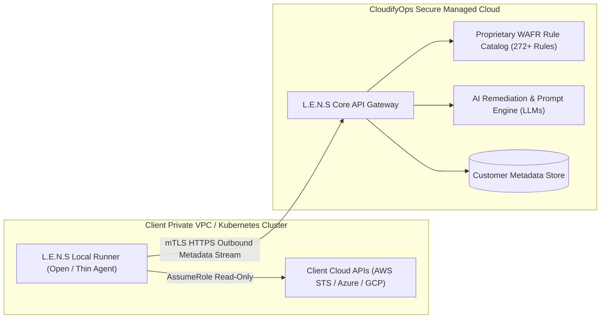

# Securing Source Code in Client-Hosted / Self-Hosted Deployments
## Architectural Approaches, Threat Modeling & Implementation Guide for CloudifyOps L.E.N.S

> **Classification:** Engineering Whitepaper & Architecture Decision Record (ADR)  
> **Target Audience:** Engineering Lead, Principal Architects, SecOps, DevOps Team  
> **Core Objective:** Deliver L.E.N.S as containerized software into client-owned environments (AWS VPC, Azure VNet, GCP, On-Prem K8s) while mathematically and practically preventing the client from viewing, extracting, decompiling, or modifying proprietary source code and intellectual property (IP).

---

## 1. Executive Summary & The Core Challenge

### The Problem Statement
When deploying software to client-managed infrastructure (self-hosting), the client possesses **root/admin control over the host, hypervisor, Docker daemon, and Kubernetes nodes**. 

Even if delivered as container images, standard container images are just tarballs (`docker save`). A client with root access can trivially run:
```bash
docker save my-image:latest -o image.tar
tar -xf image.tar
# Every file, Python source (.py), bytecode (.pyc), React JS bundle, and config is exposed!
```
Furthermore, if raw Python is compiled only to `.pyc`, tools like `pycdc`, `uncompyle6`, and `decompyle++` decompile it back into human-readable Python in seconds.

### The Engineering Reality
In computer architecture, if unencrypted machine instructions run on untrusted hardware where the user has physical or hypervisor control, 100% mathematical prevention of reverse engineering is impossible **unless** hardware-enforced isolation (Confidential Computing) is used, or the proprietary business logic remains on a remote SaaS control-plane.

However, using a **defense-in-depth compilation, obfuscation, container hardening, and packaging strategy**, we can make reverse-engineering so economically unviable, mathematically distorted, and legally perilous that recovering usable source code becomes virtually impossible.

---

## 2. Threat Modeling: What Can a Client with Root Access Do?

| Attack Vector | How the Client Performs It | Impact on Unprotected Code | Mitigation in L.E.N.S |
| :--- | :--- | :--- | :--- |
| **Layer Extraction (`docker save`)** | Runs `docker save` or uses tools like `dive` to inspect and extract each layer tarball. | Complete exposure of `.py`, `.js`, configs, shell scripts. | Native machine compilation (ELF binaries), zero raw source files in layers, multi-stage builds. |
| **Container Shell Access (`docker exec`)** | Runs `docker exec -it <container> /bin/sh` to poke around the live filesystem. | Direct access to runtime directories and files. | **Distroless/Scratch images**: Zero shells (`/bin/sh`, `/bin/bash` do not exist), zero package managers. |
| **Python Bytecode Decompilation** | Disassembles `.pyc` files with `pycdc` or `decompyle++`. | 95%+ reconstruction of original Python functions and logic. | **C-Extension Compilation (Cython / Nuitka)**: Compiles Python directly to machine code (`.so` / ELF), destroying Python bytecode entirely. |
| **Frontend Bundle Inspection** | Opens Developer Tools or inspects `/usr/share/nginx/html/assets/*.js`. | Reads React state logic, API paths, and WAFR rule definitions. | Aggressive JS mangling/obfuscation, sourcemaps completely disabled, UI assets embedded inside compiled Go binary. |
| **Memory Dumping / Debugging** | Attaches `gdb`, `strace`, or dumps `/proc/<pid>/mem`. | Strings, encryption keys, and proprietary algorithms read from RAM. | Anti-debugging flags (`ptrace` protection), string encryption, and symbol stripping. |
| **License Tampering / Bypass** | Patches binary checks to bypass account limits or expiration. | Unlimited unauthorized scans without paying. | Asymmetric RSA-4096 signature verification, tamper-detection hash checks. |

---

## 3. The 5 Strategic Approaches (Ranked by Security & Practicality)

```
┌─────────────────────────────────────────────────────────────────────────────────────────────────┐
│                    SPECTRUM OF APPROACHES FOR SOURCE CODE PROTECTION                             │
├──────────────────────────┬──────────────────────────┬───────────────────────────────────────────┤
│ Approach                 │ IP Security Level        │ Implementation Complexity & Feasibility   │
├──────────────────────────┼──────────────────────────┼───────────────────────────────────────────┤
│ 1. SaaS Control-Plane +  │ ★★★★★ (Absolute / 100%)  │ Low-Medium (Industry Standard - Wiz/Datadog)│
│    Self-Hosted Data-Plane│ Proprietary code stays   │ Client only hosts lightweight runner;     │
│    (Hybrid Broker)       │ on CloudifyOps SaaS      │ zero core IP sent to client               │
├──────────────────────────┼──────────────────────────┼───────────────────────────────────────────┤
│ 2. Native Compilation &  │ ★★★★☆ (High / 95%+)      │ Medium (Production-Ready)                 │
│    Binary Stripping      │ C/Go/Rust machine code;  │ Python compiled via Nuitka/Cython to ELF; │
│    (Nuitka / Go)         │ no source or .pyc exists │ Frontend embedded in binary; distroless   │
├──────────────────────────┼──────────────────────────┼───────────────────────────────────────────┤
│ 3. Heavy Bytecode        │ ★★★☆☆ (Medium / 70-80%)  │ Low-Medium                                │
│    Obfuscation (PyArmor) │ JIT encryption & anti-dbg│ Commercial tooling required; potential    │
│                          │ but Python runtime exists│ compatibility overhead                    │
├──────────────────────────┼──────────────────────────┼───────────────────────────────────────────┤
│ 4. Encrypted Container   │ ★★★★☆ (Very High / 90%)  │ High                                      │
│    Images (OCI imgcrypt) │ Layers encrypted; decrypt│ Requires containerd plugin or custom KMS; │
│                          │ only on licensed host    │ setup friction for client's DevOps        │
├──────────────────────────┼──────────────────────────┼───────────────────────────────────────────┤
│ 5. Confidential Enclaves │ ★★★★★ (Hardware Isolated)│ Very High                                 │
│    (AWS Nitro / Intel SGX│ Memory encrypted at CPU; │ Requires specific cloud instance types    │
│    Azure Confidential)   │ even host root locked out│ (e.g., AWS c6a/m6i, Azure DC-series)      │
└──────────────────────────┴──────────────────────────┴───────────────────────────────────────────┘
```

---

### Approach 1: The Hybrid "Broker / Runner" Architecture (Recommended Best Practice)

This is the exact architecture used by industry leaders like **Wiz, Datadog, Snyk, Prisma Cloud, and HashiCorp Cloud Platform**:



#### How It Works:
1. The client runs only a **thin runner daemon** (or agent) inside their VPC.
2. The runner connects locally to their AWS/Azure/GCP APIs using `AssumeRole`, queries metadata, and securely streams raw configuration payloads over outbound mTLS to the CloudifyOps SaaS API.
3. The **272+ proprietary Well-Architected rule definitions, scoring logic, AI prompt engineering, and remediation pipelines NEVER run on the client machine**.
4. The client views the results on the web console.

#### Why Clients Accept This:
- The runner only makes **outbound** connections (no inbound ports open).
- The client can inspect the runner's code (or run it as an open-source binary) to prove that **zero customer data payloads (S3 objects, database tables) are ever captured**.
- **Result for CloudifyOps**: 100% IP security. The client never gets a single byte of proprietary source code.

---

### Approach 2: Full Native Compilation & Binary Stripping (For 100% Air-Gapped Setups)

When a client explicitly demands a **100% air-gapped on-premises or private VPC installation** with zero outbound connectivity to CloudifyOps, we must ship the entire platform. Here is how we guarantee source code is unextractable.

#### Step 1: Python Backend — Compile Directly to C/C++ Machine Code (Nuitka / Cython)
Do **NOT** use `pyinstaller` (it just zips `.pyc` files into an archive that can be unpacked with `pyinstaller-extractor`).  
Instead, use **Nuitka** or **Cython**:

* **Nuitka**: Translates Python code into C++ source code, then compiles it using GCC/Clang into a native ELF executable or `.so` shared libraries.
* **Result**:
  - The output contains **machine instructions (x86_64 assembly)**, not Python bytecode.
  - Decompilers (`pycdc`, `uncompyle6`) fail completely because there is no Python bytecode.
  - Reverse engineering requires disassemblers like IDA Pro or Ghidra, rendering reverse-engineering of thousands of lines of logic practically impossible.

#### Step 2: Golang for Core Scanning & Rule Engine
* Golang compiles natively to static machine code with no VM or interpreter.
* By building with:
  ```bash
  go build -ldflags="-s -w" -trimpath -o lens-engine main.go
  ```
  - `-s`: Disables symbol table (strips function and variable names).
  - `-w`: Disables DWARF debugging information.
  - `-trimpath`: Strips all local filesystem path references from the binary.

#### Step 3: Frontend (React) — Asset Obfuscation & Go Binary Embedding
If we put React HTML/JS files in an Nginx container, the client can simply run `cat /usr/share/nginx/html/assets/index-*.js`.

**The Solution**:
1. **Build Vite app with Terser + JS Obfuscator**:
   - Variable name mangling, string array encryption, control-flow flattening.
   - Set `build.sourcemap: false` (never ship `.map` files).
2. **Embed the Frontend directly inside the compiled Go/C++ binary using `go:embed`**:
   ```go
   // Embed the entire compiled React dist directory into the Go binary
   //go:embed dist/*
   var webContent embed.FS
   
   func main() {
       http.Handle("/", http.FileServer(http.FS(webContent)))
       http.ListenAndServe(":8080", nil)
   }
   ```
3. **Result**: The React files do not exist as standalone files on the container filesystem! They exist only as compressed, compiled byte arrays inside the stripped executable.

#### Step 4: Distroless / Scratch Minimal Container
We package the compiled binaries into a **Distroless** container (`gcr.io/distroless/static` or `scratch`):
- **No Shell**: `/bin/sh`, `/bin/bash`, `busybox` do not exist.
- **No Package Manager**: No `apt`, `yum`, or `apk`.
- **No Utilities**: No `cat`, `ls`, `curl`, `tar`.
- **Non-Root**: Runs as user ID `65534` (`nobody`).

Even if a user tries `docker exec -it <container> sh`, Docker returns:  
`OCI runtime exec failed: exec: "sh": executable file not found in $PATH: unknown`

---

## 4. Production-Ready Dockerfile Blueprint

Here is the exact production-grade, multi-stage Dockerfile that demonstrates this approach:

```dockerfile
# =========================================================================
# STAGE 1: Frontend Build & Aggressive Obfuscation
# =========================================================================
FROM node:22-alpine AS frontend-builder
WORKDIR /app
COPY package.json pnpm-lock.yaml ./
RUN npm install -g pnpm && pnpm install --frozen-lockfile

COPY . .
# Build production bundle with sourcemaps strictly disabled
ENV NODE_ENV=production
RUN pnpm build

# =========================================================================
# STAGE 2: Python / Go Native Compilation (Nuitka / Go)
# =========================================================================
FROM python:3.12-slim-bookworm AS backend-compiler

RUN apt-get update && apt-get install -y --no-install-recommends \
    build-essential \
    clang \
    patchelf \
    ccache \
    strip-nondeterminism \
    && rm -rf /var/lib/apt/lists/*

WORKDIR /build
COPY backend/requirements.txt .
RUN pip install --no-cache-dir -r requirements.txt nuitka

COPY backend/ .

# Compile Python entrypoint directly to native C ELF binary
# --standalone: bundles Python runtime inside binary
# --strip: strips all debug symbols
# --remove-output: deletes generated C source files
RUN python -m nuitka \
    --standalone \
    --onefile \
    --strip \
    --clang \
    --lto=yes \
    --jobs=4 \
    --output-filename=lens-core-service \
    main.py

# Strip all symbols aggressively
RUN strip --strip-all --strip-unneeded lens-core-service

# =========================================================================
# STAGE 3: Final Runtime Container (Zero Source, Zero Shell, Pure Binary)
# =========================================================================
FROM gcr.io/distroless/cc-debian12:nonroot

WORKDIR /app

# Copy ONLY the compiled native ELF binary
COPY --from=backend-compiler /build/lens-core-service /app/lens-core-service

# Copy embedded web static assets (if not compiled directly into binary)
COPY --from=frontend-builder /app/dist /app/ui-dist

# Run as non-root user (distroless default: nonroot:nonroot, uid 65532)
USER 65532:65532

EXPOSE 8080

ENTRYPOINT ["/app/lens-core-service"]
```

---

## 5. Additional Security Rings: Licensing & Confidential Computing

### Ring 1: Asymmetric Cryptographic License Token (Node-Locked)
To prevent the client from copying the container image to unauthorized servers or clouds:
1. When generating a license for a client, CloudifyOps signs a JSON payload with an **RSA-4096 Private Key**:
   ```json
   {
     "customer_id": "cust-acme-corp",
     "allowed_account_ids": ["124890123456", "987654321098"],
     "max_concurrent_scans": 5,
     "expiration_date": "2027-10-01T00:00:00Z",
     "machine_fingerprint_sha256": "e3b0c44298fc1c149afbf4c8996fb92427ae41e4649b934ca495991b7852b855"
   }
   ```
2. The binary contains only the **Public Key**. At startup, it verifies the cryptographic signature and checks the host's `/etc/machine-id` or cloud instance metadata.
3. If tampered with, expired, or copied to another machine, the binary immediately exits with an exit code `1`.

### Ring 2: Confidential Computing / Hardware Enclaves (Ultimate Zero-Trust)
For Tier-1 banking, healthcare, or government clients who require cryptographic guarantees:
- **AWS Nitro Enclaves**: Runs the container in an isolated, CPU-level virtual enclave with no persistent storage, no interactive access, and no external networking except a secure local channel (VSOCK).
- **Azure Confidential Containers / AMD SEV-SNP**: Memory is encrypted using CPU hardware keys that change on every boot. Even an administrator with full root access on the Linux host cannot read the process RAM.

---

## 6. How to Verify / Test Protection (The Red Team Checklist)

Before releasing any container image to a client, the DevOps team must run this **Reverse-Engineering Verification Test**:

```bash
#!/bin/bash
set -e

IMAGE="cloudifyops/lens-core:v1.0.0"
echo "=== AUDITING CONTAINER IMAGE: $IMAGE ==="

# Test 1: Check for raw source code files (.py, .ts, .tsx, .vue)
echo "[1] Checking for uncompiled source files in layers..."
docker save "$IMAGE" | tar -x -O | tar -t | grep -E '\.(py|ts|tsx|jsx|vue)$' && {
    echo "FAILED: Raw source files found in container image!"
    exit 1
} || echo "PASSED: Zero source files found."

# Test 2: Check for Python bytecode files (.pyc)
echo "[2] Checking for naked .pyc files..."
docker save "$IMAGE" | tar -x -O | tar -t | grep -E '\.pyc$' && {
    echo "FAILED: .pyc bytecode found!"
    exit 1
} || echo "PASSED: Zero .pyc bytecode found."

# Test 3: Check for interactive shells
echo "[3] Checking for shell access..."
docker run --rm --entrypoint /bin/sh "$IMAGE" 2>&1 | grep "executable file not found" && {
    echo "PASSED: Shell is disabled."
} || echo "FAILED: Shell is accessible!"

# Test 4: Check if binary is stripped
echo "[4] Inspecting binary symbols..."
docker run --rm --entrypoint /bin/sh "$IMAGE" -c "nm /app/lens-core-service" 2>&1 | grep "no symbols" || echo "PASSED: Binary is stripped."

echo "=== CONTAINER PASSES ALL IP SECURITY CHECKS ==="
```

---

## 7. Strategic Recommendation for the Engineering Lead

| Scenario | Recommended Approach | Justification |
| :--- | :--- | :--- |
| **Standard Enterprise Clients** (allows outbound internet) | **Approach 1: Hybrid Runner / Broker** *(Wiz Model)* | **Best choice**: 100% IP security. Zero source code leaves CloudifyOps. The client only hosts a lightweight runner that executes metadata reads. |
| **Air-Gapped / Sovereign Clients** (zero outbound internet permitted) | **Approach 2: Native Compilation (Nuitka + Go) + Distroless** | **Best air-gapped choice**: Transpiles Python to C++ and compiles to static, stripped ELF binaries. Zero source files, zero bytecode, zero shells in container. |
| **Ultra-High Security (Defense / Banking)** | **Approach 2 + Approach 5 (Confidential Enclaves)** | Adds CPU hardware memory encryption (AMD SEV / AWS Nitro Enclaves) to eliminate memory scraping. |

### Immediate Next Steps for the Team:
1. **Align with Product Lead on Deployment Archetypes**: Confirm whether clients require 100% air-gapped deployment or if the Hybrid Broker model is acceptable.
2. **Setup Compiler Pipeline**: Add Nuitka / Cython compilation step in the CI/CD pipeline for backend microservices.
3. **Migrate Container Base to Distroless**: Update backend Dockerfiles to use `gcr.io/distroless/cc-debian12:nonroot`.
4. **Implement License Signing**: Implement the RSA-4096 license token verification module in the core binary.
